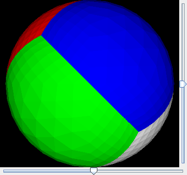
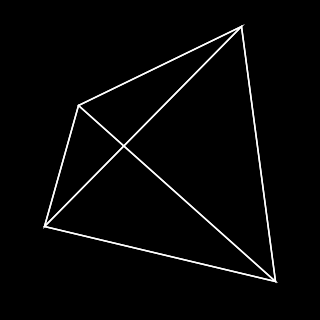
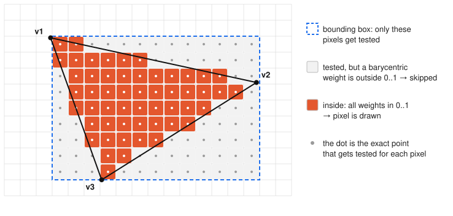
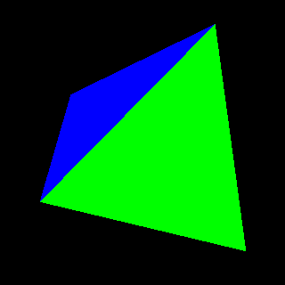
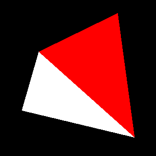
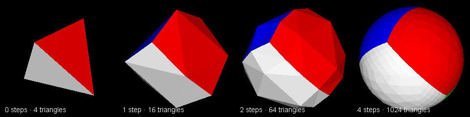

# 3D Render Engine

A 3D renderer written in Java.



## Running it

You need Java 22 or newer:

```sh
java "src/DemoViewer.java"
```

## Files

| File | What it is |
| --- | --- |
| `src/Vertex.java` | A point in 3D space: `x`, `y`, `z`. |
| `src/Triangle.java` | Three vertices and a color. Every model is just a list of triangles. |
| `src/Matrix3.java` | A 3×3 matrix that can multiply with another matrix and transform a vertex. |
| `src/DemoViewer.java` | The window, the sliders and the whole rendering pipeline. |

## How it works

Every time a slider moves, the panel repaints and the whole picture is rebuilt from scratch in
these steps.

### 1. Describe the model with triangles

The starting shape is a **tetrahedron**: a pyramid made of 4 triangles, each a different color.

```java
tris.add(new Triangle(new Vertex(100, 100, 100), new Vertex(-100, -100, 100), new Vertex(-100, 100, -100), Color.WHITE));
tris.add(new Triangle(new Vertex(100, 100, 100), new Vertex(-100, -100, 100), new Vertex(100, -100, -100), Color.RED));
// ... green and blue
```

### 2. Rotate it with matrices

The two slider values become two rotation matrices:

- **heading** rotates around the vertical **Y** axis (spinning left and right),
- **pitch** rotates around the horizontal **X** axis (tilting up and down).

```java
Matrix3 headingTransform = new Matrix3(new double[] {
        Math.cos(heading), 0, -Math.sin(heading),
        0, 1, 0,
        Math.sin(heading), 0, Math.cos(heading)
});
```

Multiplying them gives one matrix that does both rotations at once, and
`transform.transform(vertex)` moves each corner of each triangle to its rotated position.

The renderer then simply drops the `z` coordinate to place a point on the screen (an
*orthographic* projection: things don't get smaller with distance). It keeps `z` around for the
depth test in step 4.

### 3. Fill triangles with pixels (rasterization)

Drawing just the edges gives a wireframe, which was the first version:



To fill a triangle, the code:

1. finds the triangle's **bounding box** (smallest and largest `x` and `y`), so it only checks
   pixels that could possibly be inside;
2. for each of those pixels, computes three **barycentric coordinates** `b1`, `b2`, `b3`. They say
   how much each corner "pulls" on that point, and they always add up to 1;
3. if all three are between 0 and 1, the pixel is **inside** the triangle and gets colored.



```java
double b1 = ((y - v3.y) * (v2.x - v3.x) + (v2.y - v3.y) * (v3.x - x)) / triangleArea;
double b2 = ((y - v1.y) * (v3.x - v1.x) + (v3.y - v1.y) * (v1.x - x)) / triangleArea;
double b3 = ((y - v2.y) * (v1.x - v2.x) + (v1.y - v2.y) * (v2.x - x)) / triangleArea;
if (b1 >= 0 && b1 <= 1 && b2 >= 0 && b2 <= 1 && b3 >= 0 && b3 <= 1) {
    // pixel (x, y) is inside the triangle
}
```

The pixels go into a `BufferedImage`, which is drawn onto the panel at the end.

### 4. Hide what's behind: the z-buffer

If triangles are simply painted in list order, whichever comes **last** wins, even when it is
at the back:

| Without z-buffer | With z-buffer |
| --- | --- |
|  |  |

The fix is the **z-buffer**: one number per pixel that remembers the depth of whatever was
drawn there so far (it starts at negative infinity, meaning "nothing yet"). The barycentric
coordinates from step 3 also give the exact depth of the triangle at that pixel, so a pixel is
only drawn if it is closer than what's already there:

```java
double depth = b1 * v1.z + b2 * v2.z + b3 * v3.z;
int zIndex = y * img.getWidth() + x;
if (zBuffer[zIndex] < depth) {
    img.setRGB(x, y, color);
    zBuffer[zIndex] = depth;
}
```

### 5. Shading: light and dark

Flat colors look like paper cutouts. To add light, each triangle gets darker the more it turns
away from the viewer.

1. The **normal** of a triangle is an arrow sticking straight out of it. It is the **cross
   product** of two of its edges, scaled to length 1.
2. The light shines straight from the screen, so the brightness is how much the normal points at
   the viewer: `Math.abs(norm.z)`. That's 1 when the face points straight at you and 0 when you
   see it edge-on.
3. `getShade()` darkens the color by that amount.


`getShade()` does one extra trick. Colors on screen are stored in **sRGB**, where the numbers
are not proportional to the actual light (a value of 128 is much less than half as bright as 255).
So it raises each channel to the power 2.4 to get real light levels, scales those, and converts
back. Without this, the shading would look too dark and muddy.

### 6. Turn the pyramid into a sphere

`inflate()` splits every triangle into 4 smaller ones using the midpoints of its edges, and then
pushes every vertex out so it is exactly the same distance from the center. Repeating that turns
the pyramid into something more and more round. The program runs it 4 times, so 4 triangles
become 4 × 4⁴ = 1024:



You can still see the separate flat triangles in the shading, because every triangle has one
brightness.

## Ideas for what's next

- **Perspective**: divide `x` and `y` by the distance so far things look smaller.
- **Smooth shading**: compute brightness per vertex and blend it across the triangle with the
  barycentric coordinates, to hide the flat faces.
- **Load real models**: read triangles from an `.obj` file instead of the hard-coded pyramid.
- **Speed**: the model is rebuilt and inflated on every repaint; it only needs to be done once.
